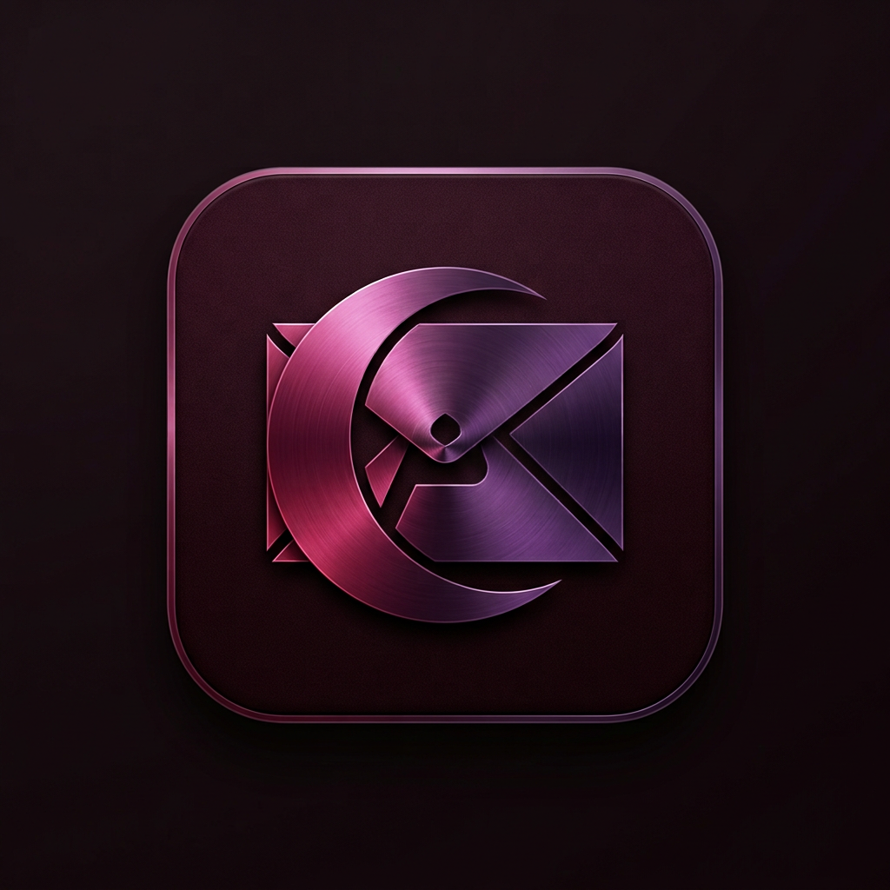
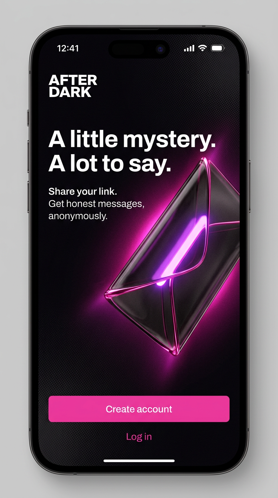
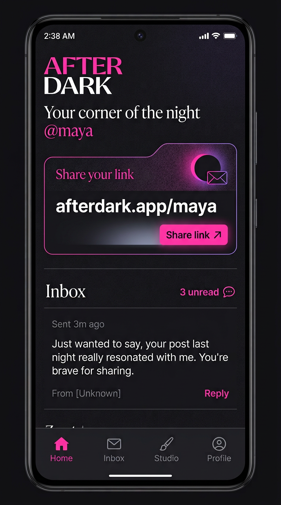
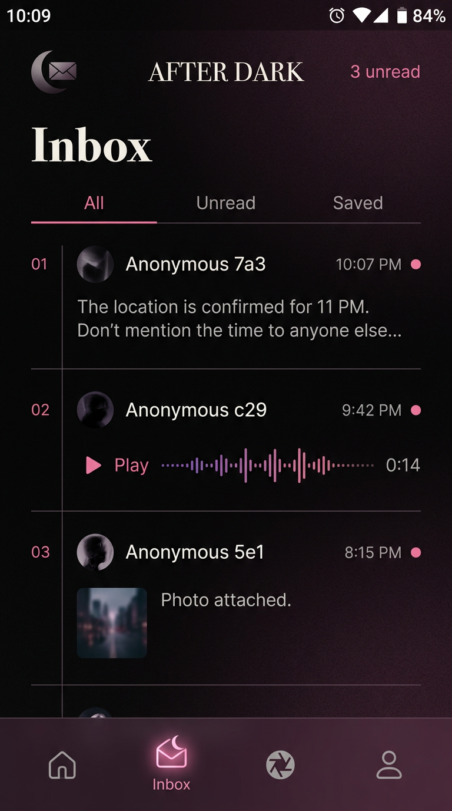
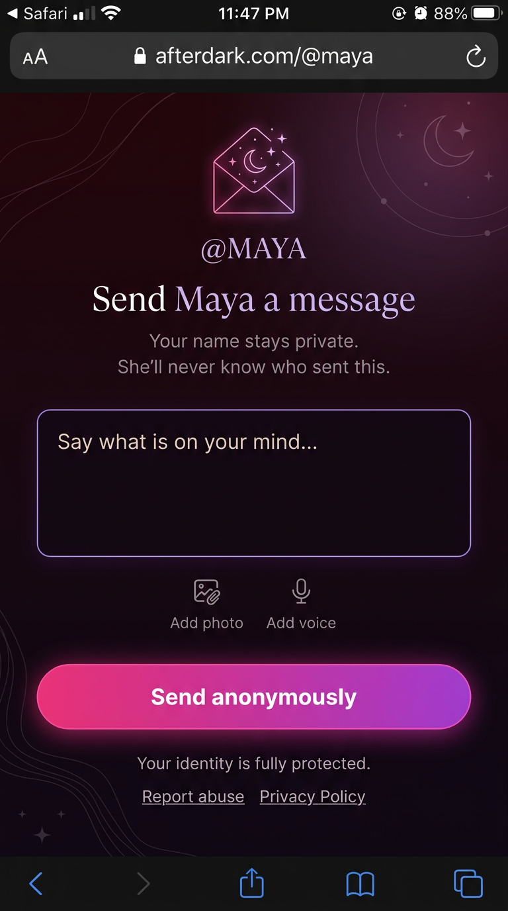
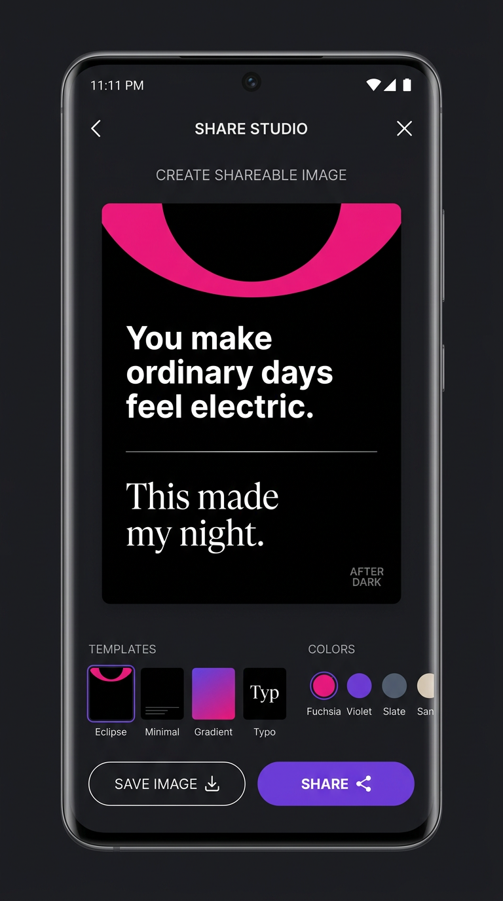
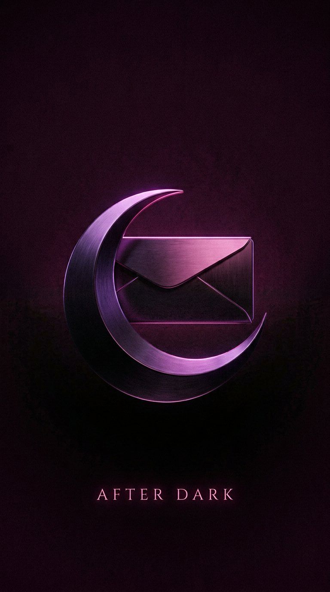
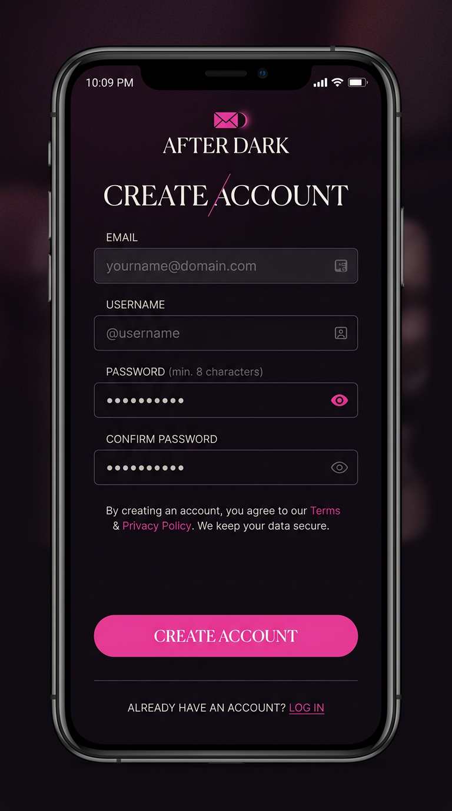
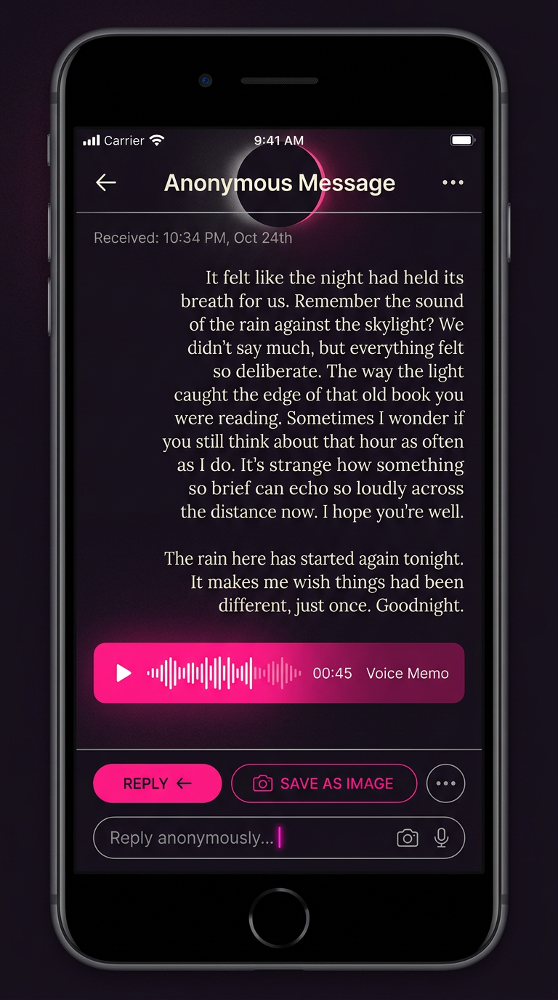
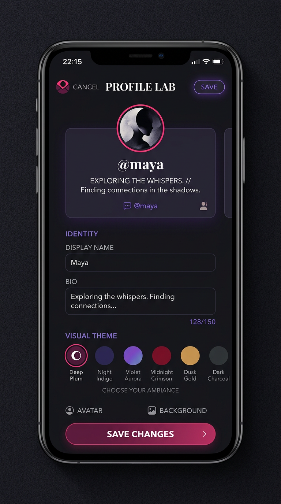

# After Dark — product and design plan

**Historical design plan:** Written before implementation began. A Supabase project and initial web/mobile code now exist; see the repository README for the current status. The visual concepts remain exploratory and no working animation has been implemented. The images below are AI-generated visual concepts, not functional screens or final production assets. Text, navigation, accessibility and brand details will be refined when the design is built.

## Creative direction: the midnight editorial

After Dark should feel like opening a private invitation after hours: expressive and cinematic, but not threatening. The visual language pairs an eclipse-and-envelope mark, sharp editorial typography, near-black plum surfaces, fine rules, and a controlled fuchsia light. A touch of violet adds depth. Large sculptural moments belong on onboarding and share cards; everyday inbox screens remain calm, readable and fast. This is a messaging product, not a generic analytics dashboard or social feed.

**Palette:** background `#09070C`, secondary background `#110D14`, surface `#19121D`, elevated surface `#241827`, pink `#F044A6`, violet `#A855F7`, highlight `#FF75C8`, white `#FFFFFF`, secondary text `#B7AAB9`. Contrast and colors must be tested on actual devices. An independently designed light theme will preserve the brand without simply inverting the palette.

**Typography and surfaces:** expressive display typography for moments of personality, with a highly legible sans-serif for forms and messages; restrained texture, hairlines, and selective translucency instead of ubiquitous rounded cards or blur. Use a consistent custom icon family. Simplify the app icon and validate it at launcher sizes before production.

## Visual concepts

### 1. App icon

A sculptural crescent and envelope signal both nighttime and messages. This is a concept, not yet a production-ready adaptive Android icon or final vector.

### 2. Welcome and onboarding

The first impression introduces the idea without asking for permissions prematurely. After the welcome: create account or log in, then complete a profile and receive a link.

### 3. Home

The personalized link is the hero action; unread messages and recent activity remain immediately accessible.

### 4. Private inbox

An editorial, readable list distinguishes text, voice and images. **Important:** any invented sender labels or identity clues in the generated image are visual artifacts and must not appear in the actual product; senders are simply anonymous. The final inbox also needs All, Unread, Answered, Pinned and Archived views.

### 5. Public message page

A personalized mobile-browser experience with clear anonymity language, a message composer, image and voice controls, and confirmation only after the server succeeds. The example domain and profile are illustrative; no actual domain has been configured.

### 6. Share Studio

The message becomes a designed artifact rather than a screenshot. Export options include saving or sharing a real rendered image, plus copying text where appropriate.

### 7. Launch animation — static keyframe

This image is a still illustrating the intended motion, **not an animation file**. See the motion specification below.

### 8. Create account

A focused form for email, username, password and confirmation, with clear validation and an immediate sign-in experience after successful registration.

### 9. Message detail

Messages should be fully readable, including long text and media, with reply, save, share and safety actions nearby.

### 10. Profile Lab

Preview changes to the public page while editing profile details, colors and backgrounds.

## Motion direction

Motion should feel like a controlled reveal, not a constant light show. The generated launch image is a visual reference only; the following timings are proposed, not implemented.

- **Launch:** a fine light slit opens into the eclipse-envelope mark (approximately 600–800 ms), then the wordmark appears. Skip immediately if the app is ready or the user has seen it recently; never block an existing session.
- **Onboarding:** each page advances with a short 200–250 ms fade/slide. The sculptural illustration shifts subtly once; avoid endless looping and expensive full-screen blur.
- **Inbox:** newly received messages gently fade into place, while unread state is communicated by a clear indicator, not motion alone. Refresh and delivery must work even without realtime.
- **Interactions:** taps produce a short press response; save/share states transition through actual progress, success or a recoverable error. Voice playback uses a functional progress indicator, not an invented waveform.
- **Reduced motion:** replace reveal and spatial movement with a short fade or an immediate state change. Respect the operating-system setting and avoid flashing.

## Complete screen and state map

These are planned screens and states; the image set is a representative visual direction, not a visual mockup for every screen.

1. **Entry & identity:** launch, onboarding, registration, login, forgot password, recovery/reset, profile creation, username availability and reserved-name errors, session restoration.
2. **Home & link:** dashboard, copy/share link, QR code, link status, notifications and meaningful empty/loading/offline/error states.
3. **Public web:** recipient page, text composer with 5,000-character counter, image preview (JPEG/PNG/WebP, up to three at 8 MB each initially), voice recording/preview (up to 120 seconds initially), upload progress, validation, challenge when warranted, retry, and server-confirmed success. Accessible on mobile and desktop without registration or app installation.
4. **Inbox:** paginated All / Unread / Answered / Pinned / Archived, detail, full text, image viewer, voice playback, mark read/unread, pin, archive, delete, report and supported abuse-blocking actions.
5. **Reply & sharing:** text, image and voice replies; reliable video only if supported; preview; export as image; copy/share; long-message handling. Templates: Midnight, After Dark Neon, Minimal, Violet Dream, Pink Confession and Pure Black, in practical portrait/square layouts.
6. **Personalization:** Profile Lab, Question Studio, public-page themes, editable profile and link presentation. No custom scripts or unsafe HTML.
7. **Account & insights:** privacy-conscious analytics, notification controls, dark/light themes, accessibility, security, account recovery, logout and account management. No claims that link visits equal unique people.
8. **Trust & operations:** reporting, moderation, restricted-account/page states, server-authorized administration and failure monitoring. No fabricated sender identity or promise of technical untraceability.
9. **Future premium architecture:** server-verified entitlements, modular for a later payment provider; no fake purchase flow or client-trusted premium flags.

## Proposed build phases — only after design approval

1. **Foundation:** finalize the icon and interface system; establish the approved repository structure, Expo/React Native mobile, Next.js public web, TypeScript shared contracts, environment documentation and CI.
2. **Secure backend:** create versioned PostgreSQL migrations and owner-scoped RLS; separate public profile access from private data; configure private storage, controlled upload flows and server-side functions. Test isolation and policy failures before exposing endpoints.
3. **Identity:** Supabase email/password auth, secure mobile session storage, profile and unique readable usernames, sign-in, recovery and session restoration. Registration is not blocked by mandatory email confirmation. Design recovery and abuse controls carefully given that requirement.
4. **Public submission:** implement and verify text, images and voice, file signature/size validation, idempotency, anti-abuse throttling, short-retention security records and meaningful upload/failure states.
5. **Inbox & delivery:** paginated private inbox, media access via authorized paths, management actions, realtime as an enhancement with refresh fallback, generic Expo push notifications and deep links.
6. **Reply, sharing & personalization:** reply workflows, real image export with long text handling, profile themes and question prompts.
7. **Quality & release:** security tests for cross-account data, storage and public endpoints; authentication and recovery; interrupted uploads; Android and browser testing; accessibility, reduced motion, low-end device performance, deployment and operating documentation.

The same real Supabase backend must serve mobile and web. Privileged keys never ship in the clients. No public feed, fake sender clues, mock authentication, or local-only message backend.

## Infrastructure status and decision needed

The initial attempt was blocked by the free-project limit. At the user’s request, Flix was later paused and a new free `after-dark` project was created in `eu-west-2`. A new GitHub repository has not been created in this design-only phase; this current checkout remains the working branch.

The region should be reviewed against the intended audience and data-residency needs. The example URL `afterdark.app` is not an acquired or configured domain.

## Approval checkpoint

Review the visual direction, privacy language, feature map and motion intent. After approval and a Supabase capacity decision, begin implementation in the phases above; do not treat these images as functioning product screens.
